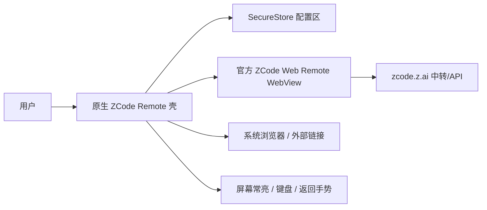

# ZCode 移动端 APP 设计

## 目标

把用户提供的 ZCode Web Remote Control 页面封装为可安装、可运行的 iOS/Android 原生应用。应用不重写 ZCode 的业务逻辑，而是加载官方移动远控 Web 前端，由原生壳层提供移动端生命周期、安全存储、错误恢复和系统集成。

## 已确认的输入

- 目标页面标题：`ZCode - Web Remote Control`
- 页面自带移动远控流程：连接中转服务、设备鉴权、等待桌面端配对、同步工作区。
- 生产 bundle 中存在 `mobileRemote` / `mobileApp` 与移动输入视口适配逻辑，说明官方 Web 端已经面向移动远控设计。
- 远控 URL 包含会话凭据，会过期且不应出现在日志、截图或普通 UI 中。

## 技术方案比较

| 方案 | 优点 | 缺点 | 结论 |
|---|---|---|---|
| **Expo + React Native WebView 承载官方 Web 端** | 功能面最完整，官方前端升级自动继承；一套代码支持 iOS/Android；可用 Expo Go 快速验证，也能出独立构建 | 不重写原生 UI；依赖官方 Web 兼容性 | **采用** |
| Capacitor WebView | Web 生态简单，也能完整承载 | React Native 生命周期、Expo Go 验证和移动端体验定制不如 Expo 顺畅 | 不采用 |
| 原生重写全部 UI/API | 理论上可完全原生 | 需要逆向未公开协议，维护成本高，功能完整性风险最大 | 不采用 |

## 架构

## 用户流程

1. 首次启动：读取本机构建的 `EXPO_PUBLIC_ZCODE_REMOTE_URL` 或 SecureStore 中保存的链接。
2. 没有配置时显示粘贴链接的设置页，只接受 `https://zcode.z.ai/remote/v4...`。
3. 有配置时直接进入全屏官方 Web Remote。
4. 深链 `zcode-mobile://connect?url=<encoded-url>` 可更新远控地址，便于从桌面端或二维码进入独立 APP。
5. Web 端处理桌面配对、工作区同步、聊天、终端和远控功能；原生壳处理连接失败、刷新、Android 返回、屏幕常亮和外部链接。

## 功能完整性策略

- 保留官方 JavaScript、WebSocket、IndexedDB、Local Storage、Cookie、文件选择器与媒体能力。
- 默认只加载 `https://zcode.z.ai`，避免把会话凭据发给第三方域。
- `zcode.z.ai` 的远控页面在 WebView 内导航；协议、商店、帮助、支付等外部页面交给系统浏览器。
- Android 后退键优先 `webView.goBack()`，不能后退时才退出。
- 远控期间保持屏幕常亮。
- 会话链接使用 `expo-secure-store` 保存，展示时脱敏。

## 非目标

- 不代理、录制或逆向 ZCode 未公开协议。
- 不在源码或文档中硬编码用户当前会话凭据。
- 不承诺桌面端离线时可用；远控依赖官方中转和桌面端在线。

## 验收标准

1. 纯函数测试覆盖 URL 校验、脱敏、深链解析和安全默认值。
2. TypeScript 与 Jest 测试通过。
3. Expo Web 构建通过，确认打包无语法错误。
4. iOS 与 Android 原生构建至少完成一个平台；若本机缺少模拟器/runtime，以原生编译结果和 Expo Go QR 作为可用运行路径。
5. 在有效远控链接与在线桌面端条件下，APP 能进入官方 ZCode 移动远控页面；链接过期或桌面离线时显示官方连接状态，不出现原生崩溃。
